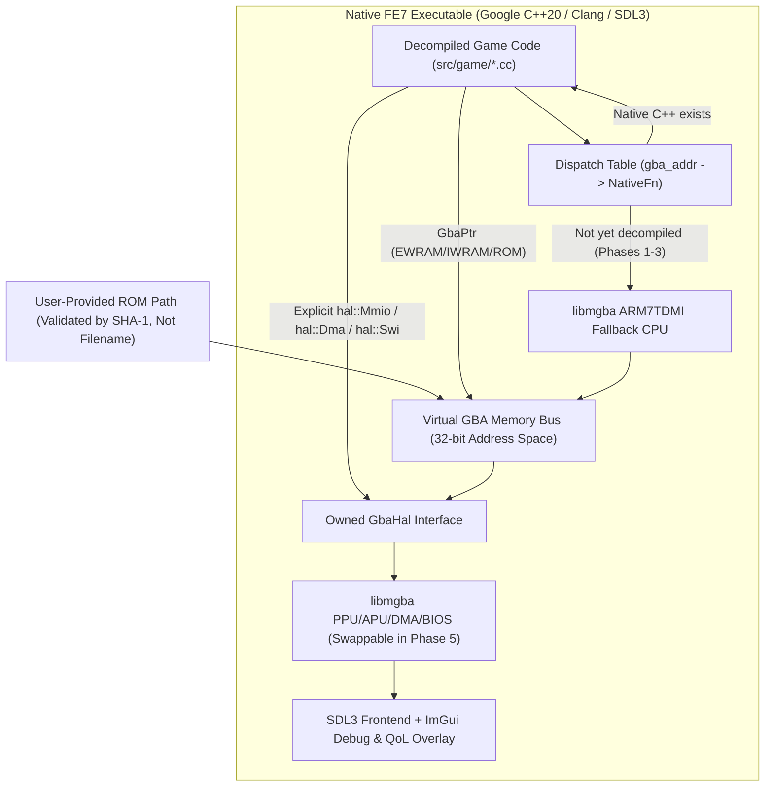
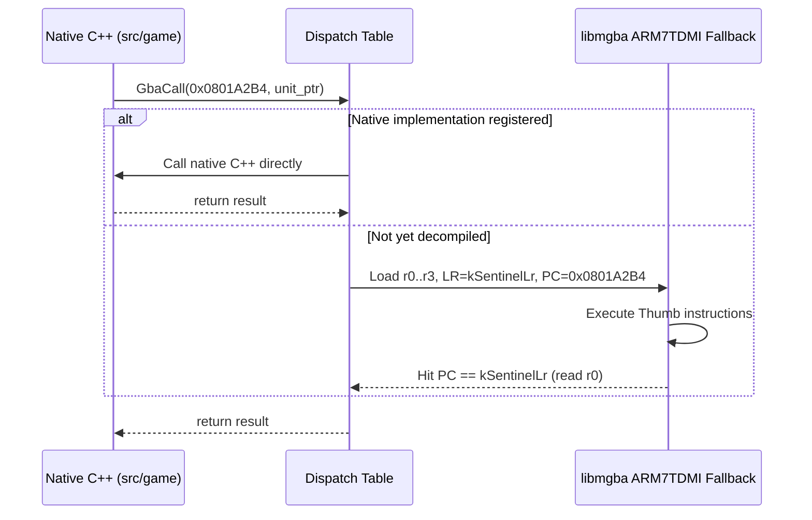

# Fire Emblem 7 (US) — AI-Driven Non-Matching Native Port Implementation Plan

## Goal Description

Build a **faithful, 100% native C++20 PC port** of *Fire Emblem: The Blazing Blade* (**FE7 US, `AE7E`**, validated by SHA-1 `c735fdbb9e8abe19e0c6a44708df19acc962e204`) targeting **Windows, Linux (including Steam Deck), and macOS**, engineered from day one with clean seams for post-1.0 modern enhancements (**widescreen 16:9 viewport**, **HD text/fonts**, **fast-forward / save states / turn rewind**, **enemy danger-zone overlay**, **mouse/gamepad support**, and **ImGui debug tooling**).

Rather than attempting a "big bang" translation of ~3,500 functions before the game boots, this plan uses a **Ship-of-Theseus (incremental replacement)** architecture:

1. **Bootable on Week 1 (Mock-Testable Immediately):** Embed `libmgba` (MPL-2.0) behind an owned `GbaHal` interface to provide an accurate GBA hardware runtime (PPU, APU, DMA, timers, IRQs, BIOS SWIs) and an ARM7TDMI fallback CPU. Validate the entire bridge in Phase 1 with **synthetic Thumb unit tests (GoogleTest)** requiring no copyrighted ROM, then drop in any SHA-1-validated FE7 US ROM for live play.
2. **Incremental Native Replacement:** AI coding agents translate batches of 5–15 related functions into strict **Google-style "C-with-types" C++20** (`.h`/`.cc`), leveraging local read-only mirrors of `fireemblem8u` and `fireemblem6j` (which share ~65–75% of Intelligent Systems' GBA engine) plus headless **Ghidra MCP** for FE7-exclusive logic.
3. **Behavioral Proof Instead of Byte-Matching:** Every decompiled function is verified against the original Thumb machine code using a **per-function differential test harness** (recorded call traces + fuzzing + ASan/UBSan) and a **full-game TAS lockstep suite** asserting identical RNG state and RAM mutations against stock mGBA.
4. **Retire the Fallback:** Once 100% of reachable game code executes natively in C++20 across full-game replays, delete the ARM7TDMI fallback core and unlock Phase 5 native PC enhancements.



---

## User Review Required

> [!IMPORTANT]
> **ROM Loading & Legal Boundary:** No copyrighted ROM bytes, extracted graphics, dialogue scripts, or music samples from *Fire Emblem 7* will be committed to the repository. The binary accepts **any ROM file path** via `--rom <path>` (or UI file picker/config) and validates **file size (16 MiB) + SHA-1 (`c735fdbb9e8abe19e0c6a44708df19acc962e204`)** rather than hardcoding a filename. All reference repos (`fireemblem8u`, `fireemblem6j`, `FireEmblem7J`, `fe7_us`) live in a gitignored `corpus/` directory for research and cross-matching only.

> [!IMPORTANT]
> **Google C++ Style Guide & Human-Gated Headers (`include/game/*.h`):**
> - All C++ code follows the **Google C++ Style Guide** (`.h`/`.cc` extensions, `Google` `clang-format`, `#ifndef FE7_..._H_` guards, `-fno-exceptions`, `-fno-rtti`, `PascalCase` types/functions, `kConstantName` constants, `snake_case` struct fields/filenames).
> - To prevent struct-layout drift across parallel AI agent batches, **all canonical POD structs (`Unit`, `Proc`, `BattleUnit`, `BmSt`, etc.) and shared headers in `include/game/*.h` are human-reviewed before merge**, locked with `static_assert(sizeof(...))` and `static_assert(offsetof(...))` checks matching FE7 US's exact RAM layout.

> [!WARNING]
> **Strict Aliasing & Host Endianness Assumption:** `GbaPtr<T>` direct-maps into mGBA's little-endian EWRAM/IWRAM/ROM buffers for clean, readable C++ (`unit->cur_hp -= dmg;`). This requires compiling `src/game/` with `-fno-strict-aliasing`, assuming little-endian desktop targets (x86-64 / ARM64), and explicitly handling unaligned ROM struct reads via helper templates where needed.

> [!NOTE]
> **mGBA Dispatch Hook Maintenance:** Intercepting Thumb/ARM function calls inside `libmgba` requires a small (~150-line) patch on a pinned `libmgba` git submodule (hooking `ARMRunLoop` / Thumb branch targets + a clean re-entrant `CallFallback(addr, r0..r3)` bridge). Because the `libmgba` CPU fallback is deleted in Phase 4, this fork only needs to track a single pinned release tag.

---

## Resolved Decisions

- **License:** **MIT** for all new `fe7` code (with pinned `third_party/mgba` patches remaining file-level MPL-2.0 until Phase 4/5 retirement).
- **Build System:** **Bazel (Bzlmod)** with Clang + C++20, GoogleTest from BCR, strict `visibility` boundaries between `src/game/` and `src/runtime/`, and focused `BUILD.bazel` overlays for `libmgba` GBA core + `SDL3`.
- **Repository:** New **private** GitHub repository named `fe7`.

---

## Proposed Changes

Changes are organized into sequential phases.

---

### Component 0: Repository Creation (`fe7`)

#### [NEW] Private GitHub repository `fe7`
- Create a new **private** GitHub repository named `fe7` via `create_github_repository` (requires this conversation to be attached to a Project).
- Initialize with:
  - `.gitignore` (explicitly ignoring `*.gba`, `*.sav`, `corpus/`, `bazel-*`, `.ghidra/`)
  - `LICENSE` (MIT)
  - `README.md` (project overview, SHA-1 ROM requirement, architecture summary)

---

### Component 1: Build System (Bazel + Clang), Google C++ Tooling & Agent Guardrails (Phase 1)

Establish a deterministic, hermetic Bazel (Bzlmod) + Clang + C++20 build with per-target caching, strict `visibility` isolation, and automated CI linting for AI agents.

#### [NEW] `MODULE.bazel`, `.bazelrc`, & `BUILD.bazel`
- Pull `googletest`, `rules_cc`, and `hedron_compile_commands` (for `clang-tidy` / `clangd`) via Bzlmod; wrap `libmgba`'s GBA core and `SDL3` with clean `third_party/` `BUILD.bazel` overlays.
- Require **C++20** and **Clang** (`--repo_env=CC=clang`, `--repo_env=CXX=clang++`) with `lld`.
- Enforce Google C++ Style Guide compiler flags + strict warnings in `.bazelrc` and `fe7_game_cc_library` Starlark macro:
  ```python
  # bazel/fe7_rules.bzl
  FE7_GAME_COPTS = [
      "-std=c++20",
      "-fno-exceptions",
      "-fno-rtti",
      "-fno-strict-aliasing",
      "-Wall", "-Wextra", "-Werror",
      "-Wsign-conversion",
      "-Wconversion",
      "-Wimplicit-fallthrough",
      "-Wshadow",
      "-Wno-unused-parameter",
  ]
  ```
- Enforce architectural isolation at the build-graph level: `//src/game/...` targets may only depend on `//include/game/...` and `//include/runtime:gba_ptr` / `gba_hal` / `dispatch` (never `SDL3`, `ImGui`, or host OS headers).
- Bazel `.bazelrc` configs:
  - `--config=asan`: `-O1 -g -fsanitize=address,undefined -DFE7_DEBUG_BOUNDS=1` (default for unit tests, `verify_fn.py`, and CI)
  - `--config=release`: `-O2 -DNDEBUG`
  - `--config=headless`: strips SDL3 window/audio deps for 1,000+ FPS TAS/differential testing

#### [NEW] `.clang-format`, `.clang-tidy`, & `tools/agent_rules.md`
- `.clang-format`: `BasedOnStyle: Google`, `ColumnLimit: 100`.
- **Strict Google "C-with-types" C++20 rules enforced by `clang-tidy` + `tools/check_agent_rules.py`:**
  - **Allowed in `src/game/`:** Free functions, POD structs with `static_assert(sizeof/offsetof)`, `GbaPtr<T>`, `GbaSpan<T>`, `ProcAs<T>()`, scoped enums, `constexpr` constants, `kViewportWidth` / `kViewportHeight`.
  - **Forbidden in `src/game/`:** Exceptions, RTTI, inheritance/`virtual` methods, heap-allocating STL containers (`std::vector`, `std::string`, `std::map`) during Phases 1–4, inline `asm`, raw `reinterpret_cast` from `uint32_t`, hardcoded `240`/`160` screen dimensions in camera/UI layout logic.

---

### Component 2: Virtual GBA Memory Bus, `GbaPtr<T>`, ROM Validator, & Dispatch Layer (Phase 1)

Provide compile-time type safety on GBA pointers, hash-based ROM validation, and seamless two-way calls between native C++20 functions and the `libmgba` ARM7TDMI fallback CPU.

#### [NEW] `include/runtime/rom_loader.h` & `src/runtime/rom_loader.cc`
- Accepts any file path (`--rom <path>`), verifies size (`16 * 1024 * 1024` bytes) and computes **SHA-1**, accepting `c735fdbb9e8abe19e0c6a44708df19acc962e204` (FE7 US `AE7E`).
- Exposes a test-only `LoadSyntheticRom(std::span<const uint8_t>)` entry point for Phase 1 mock/unit tests so the full runtime + dispatch bridge is tested without requiring a retail ROM.

#### [NEW] `include/runtime/gba_ptr.h`
Zero-cost typed wrapper around 32-bit GBA virtual addresses with debug bounds & alignment assertions:

```cpp
#ifndef FE7_RUNTIME_GBA_PTR_H_
#define FE7_RUNTIME_GBA_PTR_H_

#include <cassert>
#include <cstddef>
#include <cstdint>
#include <type_traits>

namespace fe7 {

struct GbaMemoryMap {
  uint8_t* ewram = nullptr;  // 0x02000000 (256 KiB)
  uint8_t* iwram = nullptr;  // 0x03000000 (32 KiB)
  uint8_t* rom = nullptr;    // 0x08000000 (16 MiB)
  size_t rom_size = 0;
};

extern GbaMemoryMap g_mem;

inline void* ResolveGbaRaw(uint32_t addr, size_t size, size_t align) {
  assert(addr != 0 && "Null GBA pointer dereference");
  assert((addr % align) == 0 && "Unaligned GBA pointer dereference");
  const uint32_t region = addr >> 24;
  const uint32_t offset = addr & 0x00FFFFFFu;
  switch (region) {
    case 0x02:
      assert(offset + size <= 0x40000u && "EWRAM out of bounds");
      return g_mem.ewram + offset;
    case 0x03:
      assert(offset + size <= 0x8000u && "IWRAM out of bounds");
      return g_mem.iwram + offset;
    case 0x08:
    case 0x09:
      assert((addr - 0x08000000u) + size <= g_mem.rom_size && "ROM out of bounds");
      return g_mem.rom + (addr - 0x08000000u);
    default:
      assert(false && "Use hal::Mmio* or hal::Vram* for IO/VRAM/OAM/PAL regions");
      return nullptr;
  }
}

template <typename T>
struct GbaPtr {
  static_assert(std::is_trivially_copyable_v<T>, "GbaPtr<T> requires trivially copyable POD");
  uint32_t addr = 0;

  constexpr GbaPtr() = default;
  constexpr explicit GbaPtr(uint32_t raw) : addr(raw) {}
  constexpr explicit operator bool() const { return addr != 0; }

  T* get() const { return static_cast<T*>(ResolveGbaRaw(addr, sizeof(T), alignof(T))); }
  T* operator->() const { return get(); }
  T& operator*() const { return *get(); }
  T& operator[](ptrdiff_t idx) const {
    return *GbaPtr<T>(addr + static_cast<uint32_t>(idx * static_cast<ptrdiff_t>(sizeof(T)))).get();
  }
  GbaPtr<T> operator+(ptrdiff_t n) const {
    return GbaPtr<T>(addr + static_cast<uint32_t>(n * static_cast<ptrdiff_t>(sizeof(T))));
  }
};

// Explicit typed cast for FE7 Proc* subclasses (replaces unsafe C void* casts).
template <typename SubProc, typename BaseProc>
inline GbaPtr<SubProc> ProcAs(GbaPtr<BaseProc> p) {
  return GbaPtr<SubProc>(p.addr);
}

}  // namespace fe7

#endif  // FE7_RUNTIME_GBA_PTR_H_
```

#### [NEW] `include/runtime/dispatch.h` & `src/runtime/dispatch.cc`
- O(1) lookup table mapping Thumb ROM halfword addresses (`0x08000000`–`0x08FFFFFF`) to registered native C++20 functions.
- Handles **two-way interop**:
  - **Fallback → Native:** When mGBA's ARM/Thumb core branches (`BL`, `BX`, `BLX`, or `Proc` callback) to a registered address, mGBA invokes the native wrapper (`r0..r3` + stack), stores the return value in `r0`, and sets `PC = LR`.
  - **Native → Fallback:** `GbaCall(gba_addr, args...)` invokes native C++ if registered, or saves registers, sets a sentinel return address in `LR`, runs mGBA's ARM7TDMI core until `PC == kSentinelLr`, and returns `r0`.
- Tracks per-address **fallback hit counters** (`--report-fallbacks`) for Phase 4 zero-fallback auditing.



---

### Component 3: Owned `GbaHal`, `libmgba` Bridge, SDL3/ImGui Frontend, & Mock Unit Tests (Phase 1)

#### [NEW] `include/runtime/gba_hal.h` & `src/runtime/mgba_hal.cc`
- Explicit hardware APIs:
  - `hal::MmioRead16` / `hal::MmioWrite16`, `hal::VramWrite` / `hal::PalWrite` / `hal::OamWrite`
  - `hal::DmaCopy(channel, src_addr, dst_addr, ctrl)`
  - `hal::SwiLz77UncompWram` / `hal::SwiLz77UncompVram` / `hal::SwiHuffUncomp` / `hal::SwiCpuFastSet` / `hal::SwiDiv` / `hal::SwiSqrt`
  - `hal::link::*` (clean stub interface for GBA SIO / Link Arena / optional Bonus Disk unlock toggle)
- **Phase 5 Seams preserved from Day 1:**
  - `constexpr int kViewportWidth = 240; constexpr int kViewportHeight = 160;`
  - `hal::VideoSubmitFrame()` and `hal::TextHookDrawGlyph()` seam points (no-ops during Phases 1–4 lockstep).

#### [NEW] `src/runtime/sdl_frontend.cc` & `src/runtime/tas_runner.cc`
- **SDL3 interactive frontend:** 60 Hz pacing, integer/aspect scaling, keyboard + SDL3 Gamepad input, `.sav` Flash/SRAM persistence, fast-forward toggle, instant save-state slots, and optional **ImGui debug overlay** (live RNG state, active `Proc` tree, hovered unit inspector, native vs. fallback execution % meter).
- **Headless TAS runner (`fe7-headless`):** Runs `.vbm`/`.bk2`/JSON input movies without SDL video/audio, dumping per-frame RNG state, unit array checksums, and framebuffer SHA-256 checkpoints.

#### [NEW] `tests/runtime/` (Phase 1 Mock / Synthetic Unit Tests via GoogleTest)
Validates the entire Phase 1 runtime **without needing a retail FE7 ROM**:
- `gba_ptr_test.cc`: EWRAM/IWRAM/ROM resolution, pointer arithmetic, `ProcAs<T>()`, death tests for null/unaligned/out-of-bounds/MMIO-region dereferences.
- `rom_loader_test.cc`: SHA-1 verification (rejects bad hash or wrong size regardless of filename; accepts valid hash under arbitrary filenames).
- `dispatch_roundtrip_test.cc`: Loads a **synthetic minimal GBA ROM** containing small hand-assembled Thumb functions (e.g., `ThumbAdd(a, b)`, `ThumbCallNativeHelper(x)`, `ThumbMutateEwramStruct(GbaPtr<MockUnit>)`) into `libmgba` and tests:
  1. `Native → Fallback` execution + return value & EWRAM mutation.
  2. `Fallback → Native` dispatch interception + re-entrant `Native → Fallback → Native` nesting.
  3. Fallback hit-counter reporting.
  4. Differential comparison between original Thumb execution and a C++20 reimplementation (validating the Phase 2 diff harness end-to-end on mock code!).

---

### Component 4: Reverse-Engineering Pipeline & Differential Oracle (Phase 2)

Activated once you stage your SHA-1-validated FE7 US ROM locally:

#### [NEW] `tools/ghidra_mcp/`
- Headless PyGhidra setup script (`setup_ghidra.py`) analyzing the user's validated ROM, importing symbols from `StanHash/fe7_us`, `MokhaLeee/FireEmblem7J`, and `FE_GBA_Function_Library`, and serving disassembly, decompiled pseudo-C, xrefs, and call graphs over MCP.

#### [NEW] `tools/match_fe8.py`
- Indexes local read-only clones of `FireEmblemUniverse/fireemblem8u` and `FireEmblemUniverse/fireemblem6j` (`corpus/`).
- Maps FE7 US functions to their closest FE8U/FE6J C equivalents using symbol maps + call-graph & constant/opcode similarity, generating `tools/work_queue.json` ordered bottom-up by dependency depth.

#### [NEW] `tests/diff_harness/` & `tools/verify_fn.py`
1. **Trace Capture:** `fe7-headless --rom <path> --record-traces <tas_movie>` records real execution snapshots for target functions (`r0–r3`, stack frame, pre/post dirty EWRAM/IWRAM pages).
2. **Differential Execution (`verify_fn.py --rom <path> <gba_addr>`):**
   - Compiles the touched `.cc` file under `debug-asan` (Clang + ASan + UBSan).
   - Executes **original Thumb** vs. **decompiled C++20** on recorded traces + N randomized/edge-case fuzzed inputs.
   - Asserts **exact `r0` equality** and **byte-for-byte identical EWRAM/IWRAM/MMIO diffs**. Caps automated agent retries at 5 before human escalation.

---

### Component 5: Subsystem-by-Subsystem AI Decompilation (Phases 3–4)

#### [NEW] `include/game/*.h` (Human-Gated Canonical Headers)
Google-style POD structs layout-locked to FE7 US RAM:

```cpp
// include/game/unit.h
#ifndef FE7_GAME_UNIT_H_
#define FE7_GAME_UNIT_H_

#include <cstddef>
#include <cstdint>

#include "runtime/gba_ptr.h"

namespace fe7 {

struct CharacterData;
struct ClassData;

struct Unit {
  GbaPtr<const CharacterData> character_data;  // +0x00
  GbaPtr<const ClassData> class_data;          // +0x04
  int8_t level;                                // +0x08
  uint8_t exp;                                 // +0x09
  uint8_t ai_flags;                            // +0x0A
  int8_t index;                                // +0x0B
  uint32_t state;                              // +0x0C
  int8_t x_pos;                                // +0x10
  int8_t y_pos;                                // +0x11
  int8_t max_hp;                               // +0x12
  int8_t cur_hp;                               // +0x13
  int8_t pow;                                  // +0x14
  int8_t skl;                                  // +0x15
  int8_t spd;                                  // +0x16
  int8_t def;                                  // +0x17
  int8_t res;                                  // +0x18
  int8_t lck;                                  // +0x19
  int8_t con_bonus;                            // +0x1A
  uint8_t rescue_other_unit;                   // +0x1B
  uint8_t ballista_index;                      // +0x1C
  int8_t mov_bonus;                            // +0x1D
  uint16_t items[5];                           // +0x1E
  uint8_t ranks[8];                            // +0x28
  uint8_t status_index : 4;                    // +0x30
  uint8_t status_duration : 4;
  uint8_t torch_duration : 4;                  // +0x31
  uint8_t barrier_duration : 4;
  uint8_t supports[7];                         // +0x32
  uint8_t support_bits;                        // +0x39
  uint8_t pad_3a[2];                           // +0x3A
  GbaPtr<void> map_sprite_handle;              // +0x3C
  uint16_t ai_3_and_4;                         // +0x40
  uint8_t ai_1;                                // +0x42
  uint8_t ai_1_data;                           // +0x43
  uint8_t ai_2;                                // +0x44
  uint8_t ai_2_data;                           // +0x45
  uint8_t unk_46;                              // +0x46
  uint8_t unk_47;                              // +0x47
};

static_assert(sizeof(Unit) == 0x48, "Unit struct size must match FE7 US");
static_assert(offsetof(Unit, items) == 0x1E, "Unit::items offset mismatch");
static_assert(offsetof(Unit, map_sprite_handle) == 0x3C, "Unit::map_sprite_handle offset mismatch");

}  // namespace fe7

#endif  // FE7_GAME_UNIT_H_
```

#### [NEW] `src/game/` (Decompilation Waves)

| Wave | Directory | Scope | Strategy |
| :--- | :--- | :--- | :--- |
| **Wave 1** | `src/game/engine/` | `main`, `proc`, `rng`, `hardware`, `dma`, `oam`, `bg`, `irq` (~10%) | Port from `fireemblem8u` + verify FE7 US addresses. Unlocks native `Proc` loop early. |
| **Wave 2** | `src/game/audio/` | `m4a` C driver + clean C++ `SoundMainRam` mixer + `libc`/BIOS wrappers (~10%) | Port `m4a` from `fireemblem8u`; replace hand-written ARM `SoundMainRAM` with clean C++ FIFO mixer (plus Phase 5 48 kHz seam); map `newlib`/`libgcc` to standard C++. |
| **Wave 3** | `src/game/core/` | `bmunit`, `bmitem`, `bmmap`, `bmbattle`, `bmsave` (~25%) | High FE8U/FE6J overlap; locks down core gameplay structs and combat/RNG accuracy. |
| **Wave 4** | `src/game/ai/` | `cp_*` enemy AI, phase flow, fog, weather, magic seal, tactician/ranks, supports (~15%) | Hybrid FE8U port + Ghidra MCP for FE7-exclusive mechanics. |
| **Wave 5** | `src/game/ui/` | `talk`, `face`, `font`, menus, prep screen, shop, arena, world map, event interpreter, Lyn tutorials, Link Arena UI (~20%) | Use `kViewportWidth`/`kViewportHeight` and `hal::TextHookDrawGlyph` seams; stub low-level SIO via `hal::link`. |
| **Wave 6** | `src/game/banim/` | `ekrbattle`, `efx`, spell scripts, Quintessence, Fire Dragon, CGs, sound room, credits (~20%) | Highly parallelizable state-machine procs across agent PR batches. |

#### [DELETE] Fallback CPU Bridge (End of Phase 4)
- Once `--report-fallbacks` reports **0 fallback calls** across the full-game TAS suite, remove the `libmgba` ARM7TDMI CPU fallback execution path from the build.

---

### Component 6: Phase 5 Modern PC Enhancements (Post-1.0)

1. **QoL & UX Layer (`src/runtime/qol/`):** Turn rewind (compressed ring buffer of EWRAM/IWRAM snapshots), enemy danger-zone overlay, mouse hover/click-to-move, fast-forward (2×/4×/uncapped), instant save states, controller remapping.
2. **Widescreen (16:9) & HD Text (`src/runtime/renderer_hd/`):** Swap `libmgba`'s 240×160 PPU renderer behind `GbaHal` with an SDL3 GPU/OpenGL tile/sprite renderer expanding `kViewportWidth` to 16:9, and hook `hal::TextHookDrawGlyph()` to draw crisp native-resolution TTF glyphs over dialogue boxes and stat screens.

---

## Verification Plan

### Automated Tests

1. **Phase 1 Mock Unit Test Suite (runs immediately with zero retail ROM):**
   ```bash
   bazel test --config=asan //tests/runtime/...
   bazel run @hedron_compile_commands//:refresh_all
   python3 tools/check_agent_rules.py src/ include/
   run-clang-tidy -p . src/
   ```
   Covers `GbaPtr<T>` bounds/alignment, SHA-1 ROM validation, `DispatchTable` two-way Thumb↔C++ round-trips on synthetic Thumb payloads inside `libmgba`, and mock differential comparison.

2. **Per-PR Differential & Fuzz Verification (Phases 2–4, once ROM is staged):**
   ```bash
   python3 tools/verify_fn.py --rom <path_to_rom> --changed-files --fuzz-iters 256
   ```
   Asserts 100% exact `r0` return values, byte-identical EWRAM/IWRAM/MMIO diffs vs. original Thumb in `libmgba`, and zero ASan/UBSan violations.

3. **Short Headless TAS Smoke Test (every PR, ~5s):**
   ```bash
   bazel run --config=asan --config=headless //src/runtime:fe7_headless -- \
     --rom <path_to_rom> \
     --tas tests/tas/prologue_to_ch2.tas \
     --verify-checkpoints tests/tas/golden_prologue_ch2.json
   ```

4. **Full-Game Lockstep Suite (per milestone & Phase 4 gate):**
   ```bash
   bazel run --config=release --config=headless //src/runtime:fe7_headless -- \
     --rom <path_to_rom> \
     --tas-suite tests/tas/full_game_suite.json \
     --lockstep-mgba \
     --assert-zero-fallbacks
   ```

### Manual Verification

- **Phase 1 Gate (once ROM is staged):** Launch `bazel run --config=release //src/runtime:fe7_native -- --rom <path_to_rom>` on desktop; verify SHA-1 acceptance/rejection messaging, 60 FPS video/audio, keyboard & gamepad input, Prologue gameplay, save/reload persistence, and ImGui overlay toggling.
- **Wave Gates (Phases 3–4):** Spot-check subjective visual/audio fidelity (HBlank weather/water effects, battle animation transitions, `m4a` music/SFX mixing, Huffman dialogue boxes) alongside automated RNG/RAM lockstep checks.
- **Phase 5 Gate:** Verify 16:9 map camera panning without tile-edge artifacts, crisp HD text legibility across dialogue/stat/battle-forecast menus, mouse clicking, danger-zone overlay accuracy, and turn rewind stability.
